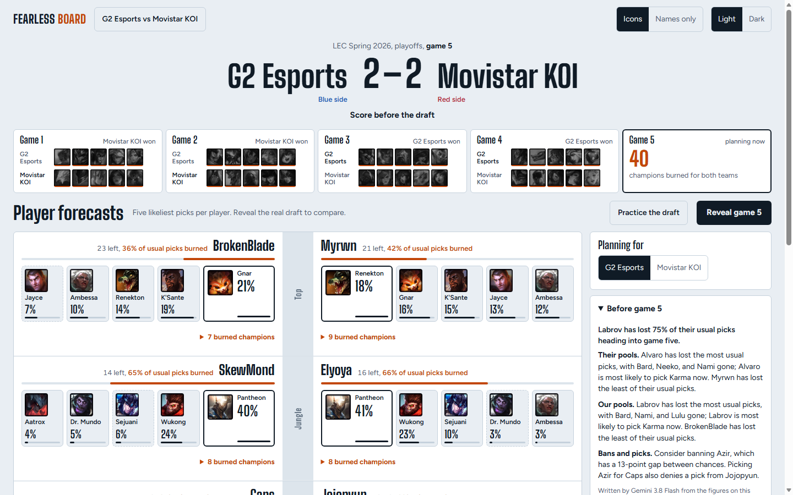
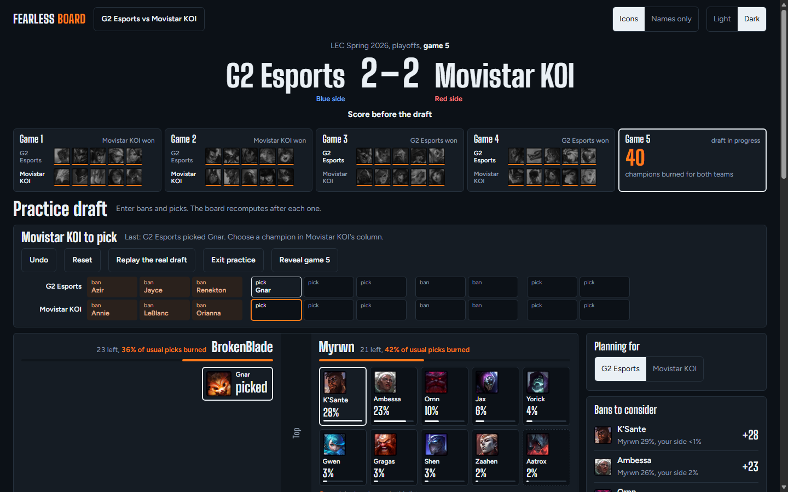
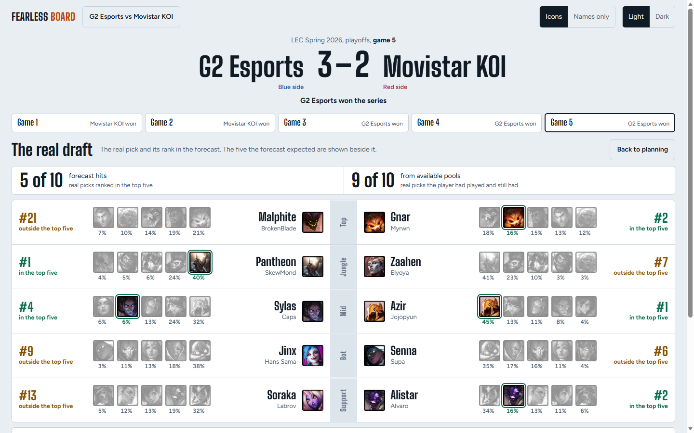

# Fearless Board

A draft desk for League of Legends series played under Fearless Draft, where a champion picked by either team is gone for both teams for the rest of the series. For any game of a series it shows which champions are burned, what each player is still likely to pick, which bans are worth considering, and, once you reveal the game, how the forecast compared with the real draft.

Built for the Cloud9 x JetBrains "Sky's The Limit" hackathon 2026, Category 2 (League of Legends).

**Try it:** https://fearless-board.web.app



## What it does

**Planning.** The two teams face each other, roles down the middle. Each player shows how much of their usual picks is burned and their five likeliest picks, sized by likelihood. The strip above the board is the series so far: every played game with its ten burned champions. The side column advises one team: a short written note, bans to consider, picks that also deny the opponent, what a pick would cost both teams, and the series outlook.

**Practice draft.** Enter bans and picks in draft order. After every action the lists and the ban advice are recomputed with those champions removed. The picking team's players show ten options to click; a search covers everything else. Undo, reset, and a replay of the real draft are available.



**Reveal.** Shows the real draft against the forecast: who won, how many real picks were in the model's top five, how many came from the players' available pools, and for each player the real pick, its rank, and the five champions the forecast expected. "Compare with forecasts" opens a detailed table.



Light and dark themes, champion icons or names only, and a layout that works from a phone to a wide screen.

## Results in brief

Measured on 2026 games with a model trained on earlier games. Details and limits are under [Method](#method).

| Question | Result |
|---|---|
| Is the real pick among the model's five likeliest? (games 2 and later, 2,460 picks) | 62.6%, against 50.1% for ranking by games played |
| The same during a draft, once earlier bans and picks are removed (4,500 picks) | 74.4%, against 62.9% before the draft |
| Is the real ban among the eight suggested? (4,499 bans) | 26.6%, against 21.1% for the most-picked champions of the last 45 days |

The ban list is a list of bans to consider, not a prediction: about three of four real bans fall outside it. The burned share of a player's pool describes the pool; in this data it does not predict who wins.

## Quick start

Requirements: Node 24 or newer, pnpm 10.

```bash
pnpm install
pnpm data        # build the aggregates from a local copy of the match data (see below)
pnpm dev         # start the app
```

Other commands:

```bash
pnpm test          # unit tests and render tests
pnpm typecheck     # type-check all packages
pnpm lint          # lint the app
pnpm build         # local build
pnpm build:site    # hosted build: all series, cleaned and checked
pnpm data:demo     # build the 20-series demo data from the full output
pnpm build:demo    # 20-series demo build
pnpm data:notes    # generate pre-game notes (needs a Gemini API key)
pnpm check:data    # verify that no data file is tracked or staged
```

## Match data

The app uses official esports data from GRID, provided for the hackathon under a proprietary licence. **The data is not in this repository and must never be committed to it.**

Clone the data repository next to this project:

```
some-folder/
├── stl-hackathon-2026-grid-starter/   <- data repo
└── fearless-board/                    <- this repo
```

```bash
git clone --filter=blob:none --sparse https://github.com/cloud9esports/stl-hackathon-2026-grid-starter.git
cd stl-hackathon-2026-grid-starter
git sparse-checkout set lol meta
```

Then run `pnpm data`. To use a different location, set `STL_DATA_DIR` to the data repository's path.

`pnpm data` writes to `packages/app/public/data/`, which is ignored by git. Run `pnpm check:data` before every commit and push; it fails if any data file is tracked or staged.

## Builds

The organisers confirmed that the draft records may be shown publicly, all series and every pick and ban included. The match data itself (match files, extracts, databases) never goes into this repository or onto the site.

- **Site (hosted):** `pnpm build:site` builds the app against the full output of `pnpm data` into `dist-site/`: all 744 series, drafts only (picks, bans, order, sides, winners, derived roles), the compact pick table and the model's four weights. Plans are computed in the browser. `scripts/clean-site.mjs` drops the demo folder, leftover files and notes written with an older prompt; `scripts/check-site.mjs` fails the build unless only the app and those data files are left and no key appears in the bundle. Firebase Hosting serves this folder (`firebase.json`).
- **Full (local):** `pnpm build`, the same app against the same data, for development.
- **Demo:** `pnpm data:demo` and `pnpm build:demo` write a 20-series build with plans precomputed (`dist-demo/`). It was the hosting plan before the organisers' answer and is kept as a small offline copy.

The 20 **featured** series (at least four games, all ten players with 20 or more earlier series, newest first) open first in the series list and are the ones with a written note before each game; the list switches to all series.

```bash
pnpm data          # build the aggregates from the match data
pnpm build:site    # hosted build, cleaned and checked
pnpm build         # local build
pnpm data:demo && pnpm build:demo   # 20-series demo build
```

## Layout

```
packages/
  shared/     types, Fearless Draft rules, the pick model, draft logic, the note check
  pipeline/   Node scripts: read the match data, train and test the model, write the aggregates
  app/        React + Vite site that loads the aggregates
scripts/      guards: no licensed data in git, and the checks on the demo build
docs/         the briefs the project was built from, and the redesign specification
```

## Method

**Pick model.** A conditional logit model scores every available champion for each player. Four features are computed per (player, champion) pair: recency-weighted games played by that player, whether the player has ever played the champion, the champion's popularity in the player's role over the last 45 days, and the champion's all-time popularity in the role. The four weights are trained on pre-2026 games with Newton's method and run in the browser as plain arithmetic; no language model is involved.

Weights: recentGames 0.0953, played 0.0740, roleMeta 1.1834, roleAllTime 0.3983. Log-likelihood per pick: −2.5912 in training, −2.7818 in the test.

Evaluation on 2026 games:

| Group | Picks | Model top 5 | Games played top 5 | Model top 10 | Games played top 10 |
|---|---|---|---|---|---|
| All | 4,520 | 62.9% | 50.3% | 85.2% | 72.5% |
| Games 2+ | 2,460 | 62.6% | 50.1% | 84.3% | 72.5% |
| Games 2+, 20+ prior games | 2,190 | 62.6% | 51.8% | 84.2% | 76.6% |

Calibration (predicted against actual pick rate):

| Bin | Mean predicted | Actual pick rate |
|---|---|---|
| 0–2% | 0.2% | 0.1% |
| 2–5% | 3.2% | 4.4% |
| 5–10% | 7.3% | 8.7% |
| 10–20% | 14.0% | 13.6% |
| 20%+ | 25.5% | 20.1% |

Limits: professional games in this dataset only; roles are derived from end-of-game state, not from official data; the bans of the current game are not used before the draft because they are not known then.

**Bans to consider.** Available champions are ranked by how much the opposing team wants them minus how much the own team wants them. The threat of a champion from a team is `1 − ∏(1 − P(player picks c))` over its five players. A ban is listed when the gap is more than two points. **Picks that also deny** are champions an own-team player has played before and has among their ten likeliest picks, sorted by the opponent's threat: picking one both uses it and removes it from the opponent for the rest of the series.

Backtest on 2026 games:

| Group | Bans | Leverage top 5 | Leverage top 8 | Threat top 5 | Threat top 8 | Meta top 5 | Meta top 8 |
|---|---|---|---|---|---|---|---|
| All games | 4,499 | 17.8% | 26.6% | 15.7% | 23.6% | 13.9% | 21.1% |
| Games 2+ | 2,459 | 18.5% | 27.4% | 16.5% | 25.4% | 15.0% | 23.5% |

**Practice draft.** After each action, banned and picked champions are removed from every player's list and the remaining probabilities are rescaled; the ban advice is recomputed from the updated lists. The draft order follows the data: six bans, six picks, four bans, four picks, expressed as "first team" and "second team", because in 2026 the red side acts first in about half of the games.

Backtest on 2026 games:

| Group | Picks | Conditioned top 5 | Unconditioned top 5 |
|---|---|---|---|
| All picks | 4,500 | 74.4% | 62.9% |
| Pick 1 | 900 | 82.8% | 78.3% |
| Pick 5 | 900 | 59.2% | 43.9% |

Second-phase bans:

| Group | Bans | Conditioned leverage top 8 | Unconditioned top 8 |
|---|---|---|---|
| All games | 1,799 | 27.3% | 20.7% |
| Games 2+ | 983 | 26.3% | 20.3% |

Limit: the backtest ranks champions for the player who actually picked; during a real draft the board does not know which role a team fills next, so all open players' lists are shown.

**Series outlook.** For each player: how much of their series-start likelihood list is already burned, and how much the coming game is expected to burn. "What does a pick cost?" shows, for a chosen champion, which players on each team lose it and the combined figure.

Backtest on 2026 games (players with 20 or more earlier games):

| Game | Picks | Mean burned share | Pick outside the series-start top 10 |
|---|---|---|---|
| 2 | 1,224 | 19.8% | 20.4% |
| 3 | 731 | 36.8% | 29.7% |
| 4 | 165 | 48.4% | 32.1% |
| 5 | 66 | 63.8% | 51.5% |

Projection of the coming game's burn (3,848 player-games): mean predicted 21.6%, mean actual 21.8%; mean absolute error 8.1 points against 8.8 for a constant.

**Written note.** A short pre-game note for each team, in the side column. It is generated in the pipeline by a Gemini model from the board's own figures and checked before it is stored: every champion name and percentage must appear in the facts it was given, the headline must be a fact about a pool and not the score, and predictions of a winner are rejected. The note restates the board's figures and adds no judgement of its own. The API key never reaches the app. Notes exist only where there is enough player history, so early series have none.

To generate notes, create a `.env` file in the project root:

```
GEMINI_API_KEY=your-key-here
GEMINI_MODEL=gemini-3.8-flash
```

Then run `pnpm data:notes`. Use `--limit N` to cap new API calls or `--series <id>` for one series.

## How it was built

The project was built in WebStorm. Each feature started as a written brief in [`docs/`](docs/), which was run through Junie in JetBrains Air. Every run was then reviewed: type check, tests, lint, builds, WebStorm inspections, an independent recomputation of the reported numbers, and a click-through of the real page. Faults were fixed in the code or written back into the brief. The reviews, a number of fixes and the final redesign ([`docs/redesign.md`](docs/redesign.md)) were done with Claude Code working alongside the IDE.

## Licence and notices

MIT, see [LICENSE](LICENSE). The licence covers this code only, not the match data.

Match data: GRID, provided for the Sky's The Limit 2026 hackathon.

Champion icons are loaded from Riot's Data Dragon and are not part of this repository's code; the app has a names-only mode that loads none. Fearless Board isn't endorsed by Riot Games and doesn't reflect the views or opinions of Riot Games or anyone officially involved in producing or managing Riot Games properties. Riot Games, and all associated properties are trademarks or registered trademarks of Riot Games, Inc.
